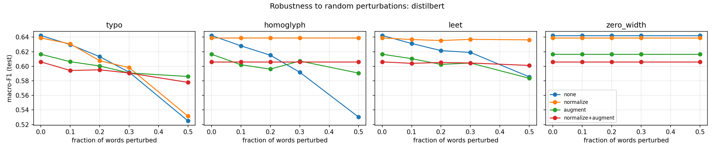
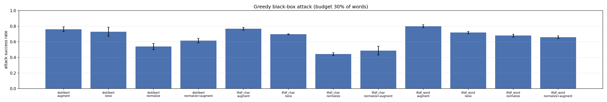

# How Robust Are Misinformation Detectors to Adversarial Text?

**Character-level evasion attacks and defenses for fake-news classifiers**

Automated misinformation detectors are deployed in an *adversarial* setting: the people spreading false claims have every incentive to slip past them. Simple tricks that humans barely notice, like typos, look-alike Unicode letters (`vаccine` with a Cyrillic `а`), leetspeak (`v4cc1ne`) or invisible zero-width characters, can change what a model "sees" completely.

This project measures **how much accuracy common misinformation detectors lose under such perturbations**, runs a **black-box adversarial attack** against them, and evaluates **two inexpensive defenses**.

> This extends my MS thesis, *Detection and Classification of Twitter Misleading Posts using Machine Learning and NLP* (COMSATS University Islamabad, 2023). The thesis asked how well we can detect misleading posts; this project asks **whether those detectors still work when someone is actively trying to fool them.**

---

## Research questions

1. **RQ1: Sensitivity.** How much does macro-F1 drop when 10–50% of the words in a claim are perturbed at random?
2. **RQ2: Worst case.** How often can a query-only attacker flip a correct prediction by changing at most 30% of the words?
3. **RQ3: Representation.** Do character n-gram and subword (transformer) models degrade more gracefully than word-level models?
4. **RQ4: Defenses.** How much robustness do input normalization and adversarial data augmentation buy, and at what cost to clean accuracy?

## Threat model

The attacker:
- **can** query the detector and observe its probability output (black-box);
- **can** apply character-level edits that keep the text readable to humans;
- **cannot** see model weights or gradients, or change the training data.

## Method

| Component | Details |
|---|---|
| **Data** | [LIAR](https://aclanthology.org/P17-2067/) (Wang, 2017), 12.8k fact-checked political statements from PolitiFact. Six truthfulness labels are collapsed to binary: *pants-fire / false / barely-true* → **misleading**; *half-true / mostly-true / true* → **credible**. Any CSV with text and label columns (e.g. a tweet dataset) also works. |
| **Models** | (a) TF-IDF word 1–2-grams + logistic regression (classic baseline, as in my thesis); (b) TF-IDF character 2–5-grams + logistic regression; (c) fine-tuned DistilBERT. Any Hugging Face model can be used via `hf:<name>`. |
| **Perturbations** (`src/perturb.py`) | `typo` (swap/delete/insert/keyboard-neighbour substitution) · `homoglyph` (Latin → identical-looking Cyrillic) · `leet` (letters → digits) · `zero_width` (invisible U+200B inside words). Applied to 10/20/30/50% of words. |
| **Attack** (`src/attack.py`) | Greedy black-box attack in the spirit of DeepWordBug (Gao et al., 2018): rank words by how much deleting them lowers the true-class probability, then perturb words in that order, picking the most damaging perturbation each time, until the label flips or the budget (30% of words) is used up. |
| **Defenses** (`src/defense.py`) | **Normalize:** Unicode NFKC + zero-width removal + homoglyph and leetspeak reversal before the model sees the input. **Augment:** add one perturbed copy of every training example (adversarial data augmentation). **Both** combined. |
| **Metrics** | Macro-F1 on clean and perturbed test sets; attack success rate (share of correctly classified examples that get flipped); adversarial accuracy; words changed per successful attack; model queries per example. |
| **Rigor** | Every perturbed test set is identical across models within a seed. Results are mean ± std over 3 seeds. |

## Results

LIAR test set (1,267 statements), 3 seeds, mean ± std. Binary macro-F1 for random guessing is ≈ 0.50.

### Key findings

1. **The most accurate model is the least robust (RQ1, RQ3).** DistilBERT has the best clean macro-F1 (0.642) but falls to **0.525** with typos and **0.530** with homoglyphs on 50% of words, close to chance. The character n-gram model starts lower (0.616) but loses at most **0.012** under any random perturbation.
2. **A few edits flip most predictions (RQ2).** By changing only **15–19% of the words**, the black-box attack flips **~70–73%** of correct predictions for every model, and adversarial accuracy drops to **~17–18%**.
3. **Input normalization is a cheap, effective defense against obfuscation (RQ4).** It restores homoglyph, leetspeak and zero-width performance almost completely at no cost to clean accuracy. It cuts attack success from 0.70 to **0.44** (char n-grams) and from 0.73 to **0.54** (DistilBERT).
4. **But the attacker adapts.** Against normalized models, **97–100%** of successful attacks rely only on typos, the one perturbation normalization cannot undo. Typos remain the open problem.
5. **Random data augmentation backfires against a worst-case attacker (RQ4).** It improves DistilBERT's macro-F1 under 50% random typos (0.525 → 0.586) but lowers clean F1 and *raises* attack success (e.g. word TF-IDF 0.72 → **0.80**). Robustness to random noise does not transfer to targeted perturbations.
6. **An implicit defense.** Zero-width characters have no effect on DistilBERT, likely because its tokenizer strips invisible formatting characters. Both TF-IDF models are affected.

### Macro-F1 on clean and perturbed test sets (50% of words perturbed)

| model | defense | clean F1 | typo | homoglyph | leet | zero-width |
|---|---|---|---|---|---|---|
| tfidf_word | none | 0.634 ± 0.000 | 0.605 ± 0.012 | 0.595 ± 0.010 | 0.608 ± 0.010 | 0.600 ± 0.014 |
| tfidf_word | normalize | 0.635 ± 0.000 | 0.605 ± 0.012 | 0.635 ± 0.000 | 0.633 ± 0.002 | 0.635 ± 0.000 |
| tfidf_word | augment | 0.617 ± 0.004 | 0.600 ± 0.008 | 0.598 ± 0.014 | 0.607 ± 0.011 | 0.599 ± 0.015 |
| tfidf_word | normalize+augment | 0.620 ± 0.004 | 0.607 ± 0.003 | 0.620 ± 0.004 | 0.619 ± 0.005 | 0.620 ± 0.004 |
| tfidf_char | none | 0.616 ± 0.000 | 0.609 ± 0.003 | 0.604 ± 0.008 | 0.607 ± 0.007 | 0.606 ± 0.005 |
| tfidf_char | normalize | 0.620 ± 0.000 | 0.609 ± 0.001 | 0.620 ± 0.000 | 0.617 ± 0.000 | 0.620 ± 0.000 |
| tfidf_char | augment | 0.610 ± 0.001 | 0.604 ± 0.001 | 0.598 ± 0.009 | 0.600 ± 0.003 | 0.601 ± 0.002 |
| tfidf_char | normalize+augment | 0.609 ± 0.001 | 0.603 ± 0.005 | 0.609 ± 0.001 | 0.609 ± 0.000 | 0.609 ± 0.001 |
| distilbert | none | 0.642 ± 0.005 | 0.525 ± 0.005 | 0.530 ± 0.002 | 0.585 ± 0.007 | 0.642 ± 0.005 |
| distilbert | normalize | 0.639 ± 0.005 | 0.531 ± 0.021 | 0.639 ± 0.005 | 0.636 ± 0.009 | 0.639 ± 0.005 |
| distilbert | augment | 0.617 ± 0.008 | 0.586 ± 0.010 | 0.591 ± 0.007 | 0.583 ± 0.007 | 0.617 ± 0.008 |
| distilbert | normalize+augment | 0.606 ± 0.005 | 0.578 ± 0.002 | 0.606 ± 0.005 | 0.601 ± 0.003 | 0.606 ± 0.005 |



### Greedy black-box attack (budget: 30% of words, 300 test examples per seed)

| model | defense | attack success rate ↓ | adversarial accuracy ↑ | words changed (successful) |
|---|---|---|---|---|
| tfidf_word | none | 0.720 ± 0.011 | 0.178 ± 0.007 | 0.168 |
| tfidf_word | normalize | 0.680 ± 0.015 | 0.203 ± 0.009 | 0.166 |
| tfidf_word | augment | 0.800 ± 0.015 | 0.124 ± 0.010 | 0.177 |
| tfidf_word | normalize+augment | 0.660 ± 0.014 | 0.214 ± 0.008 | 0.165 |
| tfidf_char | none | 0.697 ± 0.005 | 0.184 ± 0.002 | 0.187 |
| tfidf_char | normalize | **0.442 ± 0.016** | **0.340 ± 0.005** | 0.175 |
| tfidf_char | augment | 0.767 ± 0.014 | 0.138 ± 0.010 | 0.181 |
| tfidf_char | normalize+augment | 0.486 ± 0.046 | 0.307 ± 0.029 | 0.176 |
| distilbert | none | 0.728 ± 0.047 | 0.173 ± 0.029 | 0.155 |
| distilbert | normalize | 0.540 ± 0.033 | 0.297 ± 0.022 | 0.153 |
| distilbert | augment | 0.761 ± 0.025 | 0.148 ± 0.018 | 0.145 |
| distilbert | normalize+augment | 0.615 ± 0.023 | 0.228 ± 0.008 | 0.142 |



More plots: [word TF-IDF](figures/robustness_tfidf_word.png) · [char TF-IDF](figures/robustness_tfidf_char.png)

**Example of a successful attack (DistilBERT, no defense):**
> *"Marijuana is less toxic than alcohol."* → *"Mаrijuаna is leqss toxic than alcohol."* (two Cyrillic `а` + one typo). The probability of the correct label fell from 0.80 to 0.37.

## How to run

### Option A: Google Colab (recommended, free GPU)

```python
# Runtime -> Change runtime type -> T4 GPU
!git clone https://github.com/<your-username>/misinfo-robustness.git
%cd misinfo-robustness
!pip install -q -r requirements.txt

# Download LIAR
!mkdir -p data/liar && wget -q https://www.cs.ucsb.edu/~william/data/liar_dataset.zip -O data/liar.zip
!unzip -o -q data/liar.zip -d data/liar && ls data/liar

# 1) Quick check (~1 min, CPU models only, 1 seed)
!python run_experiments.py --data liar --data-dir data/liar --models tfidf_word tfidf_char --seeds 0 --out results_quick

# 2) Full study (roughly 1-2 h on a T4)
!python run_experiments.py --data liar --data-dir data/liar \
    --models tfidf_word tfidf_char distilbert --seeds 0 1 2 --out results
```

If the LIAR link ever stops working, the dataset is also mirrored on Kaggle and Hugging Face. Put `train.tsv`, `valid.tsv` and `test.tsv` in `data/liar/`.

### Option B: local

```bash
python -m venv .venv && source .venv/bin/activate
pip install -r requirements.txt
python run_experiments.py --data synthetic          # smoke test, a few seconds
python -m pytest -q                                  # unit tests
```

### Using your own dataset

```bash
python run_experiments.py --data csv --csv my_tweets.csv --text-col tweet --label-col label
```
Labels may be `0/1` or strings such as `fake`/`real` or `misleading`/`credible`.

### Useful options

| Flag | Default | Meaning |
|---|---|---|
| `--models` | `tfidf_word tfidf_char` | add `distilbert` or `hf:roberta-base` |
| `--defenses` | all four | subset of `none normalize augment normalize+augment` |
| `--rates` | `0.1 0.2 0.3 0.5` | fraction of words perturbed |
| `--attack-n` | `300` | test examples attacked (`0` = skip attack) |
| `--attack-budget` | `0.3` | max fraction of words the attacker may change |
| `--seeds` | `0 1 2` | random seeds |
| `--epochs` | `3` | transformer fine-tuning epochs |

## Output files

| File | Content |
|---|---|
| `summary.md` | Main tables (mean ± std over seeds) |
| `robustness_<model>.png` | Macro-F1 vs. perturbation rate, one panel per perturbation type |
| `attack_success.png` | Attack success rate per model and defense |
| `attack_examples.csv` | Successful adversarial examples for qualitative analysis |
| `robustness_raw.csv`, `attack_raw.csv` | Per-seed raw numbers |
| `config.json` | Exact settings used |

## Project structure

```
├── run_experiments.py     # orchestrates the full study
├── src/
│   ├── data.py            # LIAR / CSV / synthetic loaders
│   ├── perturb.py         # character-level perturbations
│   ├── models.py          # TF-IDF + LR, transformer classifier
│   ├── attack.py          # greedy black-box attack
│   └── defense.py         # normalization + adversarial augmentation
└── tests/                 # unit tests (pytest)
```

## Limitations and future work

- **Next step suggested by the results:** adversarial training on attack-generated (worst-case) examples instead of random ones, and a typo-correction front end (e.g. Pruthi et al., 2019) to close the remaining typo gap.
- Only character-level attacks; word-level (synonym substitution, paraphrasing with an LLM) attacks are a natural next step.
- Normalization reverses obfuscation (homoglyphs, leetspeak, zero-width) but **not typos**, and an adaptive attacker who knows the defense could use characters outside the mapping.
- LIAR statements are short political claims; results may differ for long articles or social-media posts.
- Certified robustness (e.g. randomized smoothing for text) and robustness of LLM-based detectors are open directions.

## References

- W. Y. Wang. *"Liar, Liar Pants on Fire": A New Benchmark Dataset for Fake News Detection.* ACL 2017.
- J. Gao, J. Lanchantin, M. L. Soffa, Y. Qi. *Black-box Generation of Adversarial Text Sequences to Evade Deep Learning Classifiers (DeepWordBug).* IEEE S&P Workshops 2018.
- D. Pruthi, B. Dhingra, Z. C. Lipton. *Combating Adversarial Misspellings with Robust Word Recognition.* ACL 2019.
- V. Sanh et al. *DistilBERT, a distilled version of BERT.* 2019.

## Author

**Mariam Fazal Abbasi** · MS Computer Science, COMSATS University Islamabad · [LinkedIn](#) · mariamfa0348@gmail.com

## License

MIT
